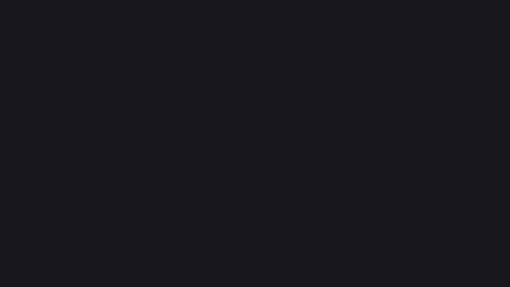
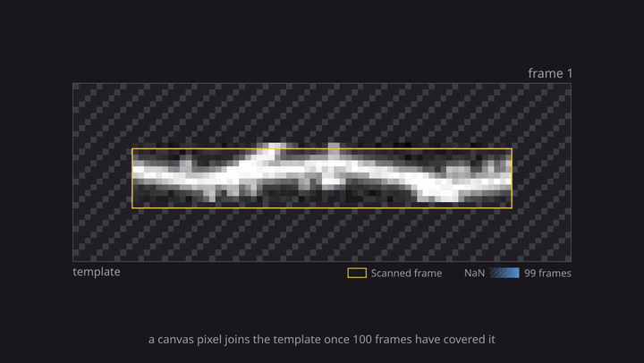
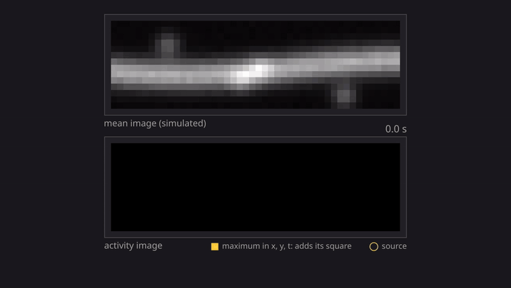

# imgui_manim

manim animations of imaging pipeline steps. This repo describes a method; its companion `imgui_ophys` lets you work the
same method by hand, one page per step. Both read one numpy model, so a model change reaches the animation and the page
together.

Each animation is a script in `animations/` built on `animations/kit.py` (manim as a drawing engine with a Cairo camera,
no `Scene`). `kit.lesson_model(name)` loads `src/imgui_manim/lessons/<name>/model.py`, or imgui_ophys's model of that
name when this repo has none. It stands in empty modules for the lesson packages, so their `__init__` files (which import
imgui_bundle) never run. The kit takes its colors from imgui_ophys's `palette.py`, so `imgui_ophys` must be checked out
beside this repo for any animation to run.

An animation is a `build()` returning nested AnimationGroups. `kit.timeline` begins every leaf in time order and
`seek(t)` scrubs to any second, so the same build gives the stills, the mp4 and the gif. `Count` makes a number react to
a morph; `Play` and `Recolor` step an image or a grid through frames.

## imgui_ophys pages

One animation per page, drawn from the page's model. Each chapter adds one idea. Titles name the content ("Add noise",
"Truncated SVD") or are absent, traces carry scale bars instead of axes, labels state the thing and its provenance
("Ground truth spikes (simulated)"), and a number counts along as the picture morphs.





```
uv run -p 3.12 animations/<page>.py --out <dir> [--stills-only] [--gif-width 720]
```

The scripts declare their own dependencies (manim, numpy, pillow). Each writes an mp4, a gif and a PNG per chapter.

## strip_registration

A thin strip drifts over a dendrite and StripRegistration adds each aligned frame to the template where it landed. A padding pixel turns blue as frames cover it and joins the template at 100.



```
uv run -p 3.12 animations/strip_registration.py --out <dir> [--stills-only] [--gif-width 720]
```

Needs `uv` and `ffmpeg` on PATH. Model tests: `pytest`.

## silo_activity

SILo's activity image builds up on a simulated strip: each space-time maximum of the matched-filtered movie adds its square to its pixel, and only the synapses accumulate. It uses the SILo page's model; `silo` above is the whole method.



```
uv run -p 3.12 animations/silo_activity.py --out <dir> [--stills-only] [--gif-width 720]
```

## compression

masknmf's compression and its denoising pass on a simulated two-photon movie: blocks, block SVD, the roughness test against noise, the blind-spot network, the second pass, and a closing table of correlation and amplitude against the true traces. The figures come from a real masknmf run stored in `src/imgui_manim/lessons/compression/run.npz`.


```
uv run -p 3.12 animations/compression.py --out <dir> [--stills-only] [--gif-width 720]
```

To regenerate `run.npz` (about 7 min on a GPU; training is not deterministic, so the numbers shift a little; delete `~/.cache/imgui_manim/compression_simulated` to compress again):

```
PYTHONPATH=~/repos/masknmf-toolbox ~/envs/pml/.venv/bin/python animations/compression_run.py
```

The same animation runs on a recording. The exporter reads any file `mbo_utilities.imread` opens (`pml_utilities` is a dependency for this), registers it, compresses it into a cache, and exports one block. A recording has no true traces, so the animation compares against the raw trace and the closing table reports noise and gain relative to raw.

```
PYTHONPATH=~/repos/masknmf-toolbox ~/envs/pml/.venv/bin/python animations/compression_run.py \
    --input <movie> --block auto --cache <dir> --out <npz> [--uint16] [--name "<name on screen>"]
uv run -p 3.12 animations/compression.py --run <npz> --out <dir> --width 1920
```

`--block auto` chooses the block whose kept candidates look most like one cell: a skewed trace over a compact, centered image, in a block where the second pass keeps more than the first and every kept candidate fits the four rows drawn. It writes `<npz>_blocks.png` with the best blocks; pass one with `--block y,x`. Compression is cached, so another block takes about 90 s. `--uint16` is for Bruker exports, which store uint16 pixels as int16.

## Miller Brain Studio

Three animations of the Studio (`mbo`, from [pml_utilities](https://github.com/FlynnOConnell/pml_utilities)). Every format and feature on screen is the package's own, and the movie is CaImAn's `demoMovie.tif`.

`graphical_abstract`: the files the Studio reads flow in, its core features appear while a movie plays, the files it writes fan out, and the pipelines it runs sit below with their results coming back in.


`suite2p_demo`: the Studio's own windows from the command line to suite2p's results. `mbo ~/data/demoMovie.tif` opens the viewer, Set Metadata gets the frame rate, the Run tab runs suite2p, the ROIs tab shows every ROI the run found, and three grouped cells plot their dF/F on the Traces panel.


`open_scrub_save`: a walkthrough of the Studio's window, from opening the movie through binning to Save as.


```
uv run -p 3.12 animations/<name>.py --out <dir> [--stills-only] [--gif-width 720]
```

`graphical_abstract` and `open_scrub_save` read `~/data/demoMovie.tif`. `suite2p_demo` reads the windows and the run stored in `animations/data/suite2p_demo`, which `scripts/studio/` regenerates in an environment with pml_utilities and suite2p: `run_suite2p.py`, `export_suite2p.py`, then `capture_windows.py`. `export_save_as.py` writes the numbers `open_scrub_save` shows.

## masknmf_pipeline

masknmf's pipeline as five manim scenes, from a movie to its traces: `MovieToTrace`, `Registration`, `Compression`, `CompressedMovie` and `SeedsAndDemix`. These are plain `mn.Scene`s rather than kit animations, drawn from one masknmf run on a simulated movie.

```
uv run -p 3.12 animations/masknmf_pipeline.py [<scene> ...] --out <dir> [-q high_quality]
```

`animations/data/masknmf_pipeline/run.npz` cannot be regenerated, because its exporter needed imgui_masknmf, which no longer exists.

## The window

`imgui-manim-window` explains how masknmf's compression splits a movie into three movies:

    registered = background + signal + residual

Each page is one manim animation, built from the movie itself and drawn by manim's Cairo camera into an imgui-bundle window. A timeline scrubs the animation forward or back while the movie plays inside its panels. Click a pixel to follow it on every page.


masknmf's `CompressionArray` rebuilds a registered frame as

    noise SD x (U V) + mean image + spatial trend x temporal trend

and `decomposition.split_pmd` names the parts:

| piece | contents | in masknmf |
|-------|----------|------------|
| background | the mean image plus a slow trend (the maximin spline detrender) | `mean_image + spatial_trend_basis @ temporal_trend_basis` |
| signal | noise SD x U V: a few smooth components per block, blended | `noise_variance_image * (spatial_compressed @ temporal_compressed)` |
| residual | registered - background - signal | `CompressionResidualArray` |

| page | chapters |
|------|----------|
| [Overview](docs/window/overview.png) | the registered movie shrinks into the first of four panels: = background + signal + residual; four traces per followed pixel: the picked one, then the highest signal SNR |
| [Raw movie](docs/window/raw.png) | a stack of recorded frames; recorded beside registered; one pixel's trace, recorded and registered |
| [Background](docs/window/background.png) | the mean image; the trend at one pixel; the background movie; registered - background, the fluctuations |
| [Residual](docs/window/residual.png) | registered - background - signal; the residual at one pixel against 2 noise SDs; its histogram over every pixel against a normal curve |

The `compression` animation above covers the blocks and the roughness test. The window has no page for them, because its block data came from imgui_masknmf.

Under the animation are the timeline (drag to scrub), the chapters (click one to play from its start), the current chapter's paragraph with this movie's numbers in it, and the movie's frame slider. Space plays and pauses, left and right step chapters, up and down step pages, Esc goes to Overview, and Ctrl +, Ctrl - and Ctrl 0 resize.

```bash
uv venv -p 3.12 && uv pip install -e ".[dev,window]"
imgui-manim-window --movie <tif or npy> --fs <Hz> [--negative]
```

`--negative` flips a movie from an indicator that dims with activity. `imgui_ophys` must be checked out beside this repo, and masknmf comes at the version pml_utilities pins. manim draws with cairo and pango, so pycairo and manimpango build from source against the system libraries on Linux. No LaTeX is needed.

`pytest` runs the model tests. With the `window` extra installed it also runs the window's tests, and one of them opens a hidden window.

```bash
python scripts/window/screenshot.py --movie <tif> --fs <Hz>                  # docs/window/<page>.png
python scripts/window/overview_gif.py --movie <tif> --fs <Hz>                # docs/animations/masknmf_overview.gif
python scripts/window/demo.py --movie <tif> --fs <Hz> --out tour.mp4         # the real window on a scripted tour
```

See [ARCHITECTURE.md](ARCHITECTURE.md).
